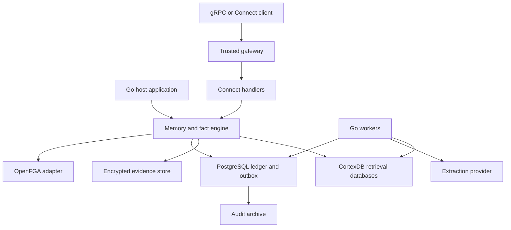

Version 0.2 · 14 October 2026 · Specification for implementation planning

Build a Go engine that turns conversations and documents into evidence-backed memories and fact proposals, governs their acceptance and supersession, and supplies authorized context to applications. The same engine runs inside a Go application or behind a separate Connect-RPC service supporting gRPC. PostgreSQL holds the authoritative ledger; CortexDB provides a rebuildable retrieval index.

The initial setting is a Singapore bank. The engine must explain what was asserted, where it came from, who accepted or changed it, and which versions an application actually received. An accepted fact means accepted under a recorded bank policy; it does not mean the engine has independently established objective truth.

# Scope and architecture decisions

| Area | Decision |
| - | - |
| Language and packaging | Go library first, with an optional service binary and worker binary |
| Durable state | PostgreSQL ledger, job queue, outbox, and operational projections |
| Retrieval | CortexDB Go adapter using PostgreSQL and pgvector; lexical retrieval remains available without an embedding provider |
| Remote API | Protobuf and Connect-RPC with gRPC compatibility; Buf and protovalidate |
| Authentication | Existing KrakenD and Ory Kratos gateway integration for remote callers; trusted host identity for embedded callers |
| Authorization | OpenFGA for this project, replacing Keto |
| Background execution | Explicit Go workers using PostgreSQL leases and a transactional outbox; Dapr is excluded |
| Database tooling | goose migrations and sqlc queries |
| Observability | OpenTelemetry with structured slog logs |
| Evidence storage | Configurable encrypted evidence store; PostgreSQL payload storage for development and a bank-managed versioned object store for production |

The first release includes conversation ingestion, evidence registration, fact and memory proposals, policy-governed acceptance, attestations, immutable fact snapshots, external calculation receipts, rejection, dispute, retraction, supersession, current and historical reads, authorized retrieval, context manifests, decision receipts, and audit export. It supports manual proposals and asynchronous model extraction through the same validation path.

Wealth onboarding is an integration use case for this reusable engine. The wealth application owns its fact catalogue, required fields, onboarding questions, business validation, client-profile construction, deterministic allocation methodology, and recalculation decisions. The engine owns evidence, typed facts, lifecycle enforcement, immutable snapshots, and provenance. Automated credit, KYC, payment, and investment decisions, a reviewer UI, a general workflow platform, unrestricted graph query endpoints, cross-tenant search, and autonomous modification of bank systems remain outside this implementation.

Three approaches were considered. Extending CortexDB's internal tables would couple audit guarantees to its update and migration behavior. A service-only implementation would prevent direct embedding. The selected design places an independent ledger and policy layer around a CortexDB adapter and exposes the same engine through both deployment modes.

CortexDB supports a Go facade and PostgreSQL backend. The inspected baseline is commit `eaf996b62f75d5e499d1b9ca7fab470a23700385`; its module requires Go 1.25.0. Pin an approved release or commit and use a supported Go toolchain satisfying its minimum. [CortexDB guide](https://github.com/liliang-cn/cortexdb/blob/eaf996b62f75d5e499d1b9ca7fab470a23700385/docs/GUIDE.md), [module](https://github.com/liliang-cn/cortexdb/blob/eaf996b62f75d5e499d1b9ca7fab470a23700385/go.mod).

# Deployment and dependency boundaries



Embedded mode imports the public Go package and adapter packages. It requires PostgreSQL for this production profile; embedded means in-process API calls, not an in-memory or zero-dependency database. The host supplies trusted actor context, configuration, logging, authorization, and lifecycle management. It may run workers in-process or delegate them to the worker binary.

Service mode wraps the same engine in thin Connect handlers. The service provides gRPC over HTTP/2 and the configured Connect transports. It does not expose CortexDB's raw mutation, MCP, SQL, or graph endpoints. Connect supports gRPC-compatible clients; protocol interoperability must be tested with a generated grpc-go client. [Connect Go](https://github.com/connectrpc/connect-go).

The engine owns its ledger transactions and does not join a caller's database transaction in version 1. A host requiring coordination with its own records uses stable command IDs and its own outbox. Neither the library nor its constructors should change global loggers or telemetry providers, start network listeners, or run ledger migrations. Application workers start explicitly. Adapter-owned CortexDB resources and background routines must be stopped by the adapter's Close operation; do not assume the upstream Open call is inert.

Use separate credentials for ledger migration, ledger application access, CortexDB projection writes, and audit export. The ledger and CortexDB may share a PostgreSQL cluster. For the first release, route each tenant to a separately provisioned CortexDB database with bounded connection pools. CortexDB namespaces remain organizational fields, not the security boundary. Sharing a CortexDB database across tenants is a later optimization requiring a complete isolation review.

# Domain model

| Entity | Meaning |
| - | - |
| Tenant | Security, retention, and ledger ordering boundary |
| Scope | An authorization collection within a tenant, such as a customer case, team, or user workspace |
| Subject | A stable bank-issued reference to the person, account, organization, or other entity discussed |
| Fact | An atomic assertion identified by tenant, scope, subject, predicate, and an explicit discriminator where needed |
| Memory | A contextual item such as an episode, summary, lesson, or decision narrative; it remains distinct from a typed fact |
| Record | The common ledger identity for a fact or memory |
| Version | Immutable content and provenance for a record |
| Evidence | An immutable source revision with an exact retrievable payload and source metadata |
| Lifecycle event | An immutable proposal, acceptance, supersession, rejection, dispute, resolution, or retraction |
| Context manifest | The exact ordered content the engine supplied for an application request |
| Decision receipt | The application's report of which context it used and the resulting decision or output reference |
| Fact snapshot | An immutable, explicitly selected set of typed fact values or resolution outcomes at one ledger revision |
| Attestation | An identified principal's confirmation, source-verification report, or application-validation report bound to exact version IDs |
| Calculation receipt | An external application's calculation identity and artifact references linked to an exact fact snapshot |

Facts use registered predicates with a value schema, cardinality, sensitivity classification, review policy, and temporal precision. Example: `customer:123 / residential_address / primary`. Version 1 supports single-valued predicates per key; concurrent memberships or roles are represented as separate keyed facts with explicit discriminators. Do not infer fact identity from vector similarity or an LLM-generated slug. The owning application publishes versioned predicate schemas and acceptance policies through authorized administration. The engine enforces type, cardinality, provenance, and lifecycle contracts; the application decides business completeness and cross-field business validity. The engine contains no built-in wealth catalogue, onboarding questionnaire, risk scoring, or allocation logic.

Values use a typed union: text, boolean, integer, decimal with unit or currency, date, instant, or entity reference. Decimals use canonical decimal strings rather than binary floating point. Unknown, absent, disputed, and false are separate states. Predicate schema changes receive a new schema version and explicit migration rules.

A memory has a subtype, body, scope, evidence references, and links to any fact versions used to derive it. Stable preferences that drive bank behavior should be modeled as typed facts. A summary may quote a disputed assertion, but its label must preserve that uncertainty. Corrections to source material or derived summaries create new versions; they do not overwrite accepted content.

Each source contribution records speaker role and source authority. Customer statements, assistant-generated text, staff attestations, and bank records must remain distinguishable. A customer's statement about an address is a customer assertion until the applicable verification policy accepts it. An extractor's confidence is diagnostic metadata, never an authorization or acceptance decision. Client confirmation, source verification, application validation, and engine acceptance are separate recorded claims; none is inferred from another. An evidence digest verifies retained bytes, not the truth of their contents.

# Evidence and extraction

Evidence registration records tenant, scope, source system, source object and revision, conversation/message identity where applicable, speaker, source time, receipt time, media type, classification, retention policy, immutable storage locator, object version, and content digest. Store original bytes and identify any normalized or redacted derivative separately, with transformation version and parent evidence ID.

An evidence locator includes the exact object version rather than a mutable path alone. Span references identify a message and UTF-8 byte range in a specified source revision, or a document page and extraction span. Validate span bounds and quoted content deterministically. Store a mapping when OCR, redaction, or normalization changes offsets. A source revision arriving again is idempotent only if its digest matches; changed bytes under the same source revision are an integrity conflict.

The evidence store finalizes and verifies the object before the ledger registers it. Failed ledger registration may leave an orphan object, handled by a retention-aware cleanup job. The reverse condition, an accepted fact pointing to an unfinished object, must be rejected. Production ingestion uses allowlisted source connectors or uploaded object references, not arbitrary caller-provided URLs fetched by the service.

Extraction follows this sequence:

1. Register immutable evidence and enqueue a durable extraction job.

2. Resolve an authorized, policy-approved input slice and preserve the exact bytes supplied to the model. Record truncation, redaction, chunk boundaries, and omitted ranges.

3. Request structured candidates: subject reference, registered predicate or memory subtype, typed value, source spans, asserted effective interval, uncertainty, and a short rationale.

4. Validate schema, tenant and scope, subject identity, supported predicate, evidence spans, and source authority. Ambiguous identity or unsupported inference becomes a review issue.

5. Compare candidates with the same fact key and relevant accepted versions. Produce duplicate or conflict links; similarity alone cannot establish contradiction.

6. Append proposals with extraction provenance. Review and acceptance are separate commands.

The extraction interface is provider-neutral and accepts typed request and response structures. A deployment supplies an approved model provider or submits manually constructed proposals. The engine does not assume that CortexDB's CLI or coding-agent hooks implement bank extraction policy. Calls have timeouts, bounded retries, input/output size limits, and per-tenant concurrency and cost quotas.

An extraction run stores provider, reported model identity, requested model version, prompt template version and digest, exact request and response payload references, generation parameters, parser/schema version, application build, evidence IDs, actor, timestamps, token usage when supplied, and outcome. Preserve provider aliases as aliases if no immutable version is available. Retained artifacts support inspection; model re-execution is not promised to produce identical output. Store concise rationale where supplied, not unavailable internal model reasoning.

Treat source text as untrusted data. Instructions inside a conversation cannot change tools, approval rules, identity, or export policy. Assistant turns can provide context but cannot independently establish a customer fact. Relative dates use the source's time and timezone; ambiguous dates remain unresolved. Reprocessing creates another run and proposal lineage, while retries of one committed command do not duplicate versions.

# Lifecycle and temporal rules

All versions begin as proposals. The configured acceptance policy produces an acceptance or rejection event, with human review where required. An accepted version becomes active only within its effective interval. Supersession accepts a replacement and replaces specifically identified prior version intervals atomically. Retraction withdraws a version for a stated interval without inventing a replacement. Dispute marks the affected interval as unusable by default until an authorized resolution event. None of these actions deletes earlier events.

Every proposed fact or memory requires at least one source link with verified storage integrity and provenance. Acceptance is governed by an application-owned, versioned policy bound to the record schema and scope. Version 1 supports manual review and explicitly enabled automated acceptance based on required version-bound attestations and deterministic engine checks. Manual review is the default when no automated policy has been configured. The engine fails closed when the policy or its prerequisites are missing; callers cannot select a weaker policy in an acceptance request.

Manual-review policies require distinct proposing and approving principals, including the initiating human behind a delegated service account. Automated policies specify allowed accepting service principals, permitted source classes, required client confirmation or source/application-validation attestations, expiry rules, and whether human review is also required. The engine checks these declared conditions; domain-specific business validation runs in the application and is recorded by an authorized validation principal. Each acceptance event retains the policy version, evidence and attestation IDs, validator identity, validation report reference, and applied engine-check results. Schema and policy publication use a separate administrative permission and are audited; OpenFGA permission to accept does not bypass policy requirements.

`RecordAttestation` appends the attestation kind, tenant and scope, exact record/version IDs and content digests, attesting principal, recording principal, source evidence, event time, and optional expiry. A client confirmation preserves the presentation the client confirmed and its response evidence. Only a trusted identity flow may bind the attesting person; a caller-supplied name is insufficient. Source-verification and application-validation reports require principals authorized for those attestation kinds. Attestations can be withdrawn through an appended event. A changed or replacement version needs its own required attestations; confirmation of an old version never confirms a new one. Accepted facts affected by expired or withdrawn prerequisites become ineligible under their recorded policy until resolved.

Use two time dimensions:

- **Valid time:** when an assertion applies in the business world, expressed as a half-open interval `[valid_from, valid_to)`. A null end means open-ended. Unknown starts remain explicit and are not silently replaced with ingestion time.

- **Ledger knowledge:** the ordered committed revision through which an observer read the tenant ledger. This is the canonical historical query boundary.

Each record has a monotonically increasing stream revision; each tenant has a ledger revision allocated under a row lock held to commit. Allocate one revision per event, reserving a contiguous block for a transaction containing multiple events. Allocate after external calls and validation, within the short append transaction. Rolled-back allocations are rolled back with the transaction. This gives committed reads a usable ordered boundary; a raw PostgreSQL sequence alone would not guarantee commit order. Multi-record commands lock record IDs in sorted order before taking the tenant append lock.

`recorded_at` is a database-generated timestamp of ledger recording, not proof of the precise instant another application could observe the commit. A `known_at` convenience filter uses recorded timestamps and returns the resolved ledger revision. Decisions and reproducible historical queries use the explicit revision token. Reads of multiple facts use a single consistent database snapshot and return its committed tenant revision.

| Event | Business effect | Knowledge effect |
| - | - | - |
| 3 March: address A accepted, effective 1 March | A applies from 1 March | Visible from that acceptance revision |
| 12 March: address B accepted, effective 10 March | B replaces A from 10 March; A remains applicable before then | Earlier ledger revisions still show A |
| 20 March: correction says B began 8 March | New correction changes the interval from 8 March | A decision captured on 9 March retains the version and content it actually used |

For a single-valued fact, acceptance may not leave two accepted, usable versions covering the same instant. An interval replacement specifies every overlapping version and the affected interval. Reject incomplete overlap sets; preserve unaffected interval segments in the derived timeline. Future-effective replacements do not retire today's fact early. Rejected candidates do not alter the accepted timeline.

An accepted derived memory becomes stale when a dependency changes over the interval it describes. The recall path checks dependency eligibility synchronously, and an asynchronous job proposes a replacement. Original memory versions remain available to authorized history and audit reads. Similarity, recency, or model confidence never chooses a winner between conflicting factual claims.

# PostgreSQL ledger layout

The tables below are a logical schema contract; implementation migrations must express the listed keys, checks, privileges, and indexes. All tenant-owned primary, foreign, and unique keys include `tenant_id`. Cross-tenant references must fail at the database boundary.

| Table | Main fields and purpose | Mutation policy |
| - | - | - |
| `tenant_revisions` | Tenant ID and committed ordering counter | Transactional counter |
| `scopes`, `subjects` | Opaque identities and controlled lookup metadata | Governed administrative changes |
| `predicate_versions`, `policy_versions` | Application-owned schemas, acceptance modes, permitted attestors/acceptors, prerequisite checks, retention and purpose policies | Append versions |
| `records` | Record ID, kind, scope, subject, fact key, stream revision | Identity fixed; counter mutable |
| `record_versions` | Version ID, record ID, typed payload reference, schema version, proposed interval, source class, proposer, extraction run | Append only |
| `evidence` | Evidence ID, immutable object/version reference, digest, source metadata, policy references | Append only |
| `version_evidence` | Version ID, evidence ID, exact locator, support or contradiction role | Append only |
| `version_dependencies` | Derived version ID and exact source version IDs | Append only |
| `extraction_runs`, `extraction_attempts` | Immutable configuration and artifacts for each attempt, completed outcome | Append only |
| `ledger_events` | Event ID, tenant revision, event type, actor chain, reason, authorization receipt, policy, recorded time and typed payload reference | Append only |
| `record_events` | Ledger event ID, record and stream revision, version IDs and affected interval for lifecycle changes | Append only |
| `accepted_intervals` | Resolved current timeline, dispute/retraction flags and revision | Rebuildable projection updated in the ledger transaction |
| `context_manifests`, `context_items` | Ordered bytes supplied, version IDs, evidence IDs, temporal boundary, retrieval and authorization metadata | Append only |
| `decision_receipts` | Context manifest or fact snapshot, host decision ID, actual input/output references, action receipt and provenance | Append only |
| `attestations`, `attestation_events` | Exact version IDs/digests, attestation kind, attesting/recording actors, evidence, expiry, and withdrawal history | Append only |
| `fact_snapshots`, `fact_snapshot_items` | Exact selectors, selection revision, creation revision, typed values/resolution states, version/schema/policy/attestation/evidence references, canonical payload digest | Append only |
| `calculation_receipts` | Snapshot ID, application/run IDs, method/build/config/reference-data identities, actual input/output artifact references, execution times and outcome | Append only |
| `command_receipts` | Principal, operation, idempotency key, canonical request digest, committed result IDs | Immutable after commit |
| `jobs`, `outbox`, `consumer_offsets` | Lease, retry, delivery and per-consumer progress | Operational mutable state |
| `audit_batches`, `retention_events` | Signed archive manifests, object receipts, hold/purge actions | Append only |

Create unique constraints on `(tenant_id, record_id, stream_revision)` in record events and `(tenant_id, ledger_revision)` in ledger events, plus the fact natural key and command identity. Version references include their owning record in composite constraints. Ledger events cover evidence registration, lifecycle changes, context delivery, decision receipts, exports, and governed administrative actions; operational lease heartbeats need no business event. Index evidence source revisions, subject/predicate/scope lookup, timeline ranges, event revision, pending jobs, dependencies, and manifest-to-version links. Snapshot items have stable ordinal positions and unique selector identities within each snapshot; record references include the tenant. Calculation runs are unique by tenant, application ID, and external run ID, with idempotency rejecting changed payloads for the same identity. Snapshot, attestation, and receipt events participate in the same tenant ordering and audit export.

Enable and force row-level security on tenant ledger tables, using transaction-local tenant context and explicit tenant predicates in sqlc queries. Runtime roles are not table owners, superusers, or `BYPASSRLS` roles. Revoke UPDATE, DELETE, and TRUNCATE on append-only tables from normal runtime roles. Ownership and administrative powers remain a separate operational trust boundary. PostgreSQL documents that privileged roles can bypass RLS and that TRUNCATE is not covered by row policies. [PostgreSQL row security](https://www.postgresql.org/docs/current/ddl-rowsecurity.html).

Store sensitive payloads in encrypted blobs or envelope-encrypted fields so retention can remove content without rewriting the structural event history. Do not put raw account numbers, names, addresses, or conversation excerpts into record IDs, OpenFGA objects, metrics labels, or event reason codes.

# Command transaction and background execution

Every mutation carries an idempotency key, trusted tenant and actor context, purpose, and trace correlation. Record lifecycle commands also carry the expected stream revision. A supersession supplies the candidate version, replaced version IDs, effective interval, evidence, and reason code.

1. Validate the typed request, resolve identity, and authorize the operation and referenced resources. Complete model and evidence-store calls before acquiring ledger locks.

2. Begin a ledger transaction. Bind tenant context, check the command receipt, and lock affected records in stable order.

3. Recheck expected revisions, evidence eligibility, the bound policy version and active configuration, required attestations and their exact versions/expiry, separation of duties where the policy requires it, and interval invariants against locked state. Use a short-lived authorization receipt tied to the actor, resource, operation, and model ID.

4. Allocate the tenant revision, append immutable records and events, update the accepted interval projection, and insert durable jobs/outbox entries and the command receipt.

5. Commit and return the version/event IDs, stream revision, tenant revision, and projection status. A crash after commit is recovered by retrying the same command.

The command key is scoped by tenant, principal, and operation. Identical retries return the recorded outcome after current access authorization. Reuse with different canonical input returns a conflict. Revision conflicts return the current revision without an automatic blind overwrite. Bound transaction retries and preserve the same command identity.

PostgreSQL workers claim available jobs with `FOR UPDATE SKIP LOCKED`, assign expiring leases and fencing tokens, then perform external work outside the claim transaction. Lease renewal and completion require the current token. Delivery is at least once; every consumer deduplicates by immutable event or job ID. Failed jobs back off with jitter and eventually enter a visible failed state with a controlled retry command.

No message broker is required. Polling is the durable wake-up mechanism; optional LISTEN/NOTIFY only reduces latency. Each consumer maintains a contiguous acknowledged revision and gap tracking rather than treating the largest observed ID as complete. Projection status and audit archive status are separate. Future broker adapters consume the same outbox contract. Fact-change envelopes include event ID, tenant ledger revision, record ID, prior/new version IDs where applicable, affected interval, change type, and reason code. Consumers can replay them through ListChanges and resolve affected snapshot/run dependencies under authorization. The application determines whether a change matters to its methodology and requests any new snapshot or calculation; the engine neither reruns allocation nor rewrites earlier receipts.

PostgreSQL and OpenFGA do not participate in a distributed atomic transaction. Checks are made near the command and use a bounded freshness window; record the result and timing. A permission change already visible to a fresh check must deny the operation, but immediate linearizable revocation across an in-flight transaction is not promised. Processes requiring that guarantee need a coordinated authorization revision protocol beyond this first release.

# CortexDB integration and retrieval

The adapter indexes accepted versions using a stable projection ID derived from tenant, version ID, and index generation. It supplies content, scope, record/version IDs, policy-safe metadata, source class, and validity information. Retries upsert the same immutable version content. The ledger remains the owner of lifecycle decisions.

CortexDB's inspected `SaveMemory` implementation performs its memory upsert, supersession metadata updates, and graph updates through separate operations. It does not accept the ledger's SQL transaction. The transactional outbox provides the integration boundary; the engine never assumes a joint commit. The upstream change feed also has retention controls and is supplementary diagnostics. [Memory implementation](https://github.com/liliang-cn/cortexdb/blob/eaf996b62f75d5e499d1b9ca7fab470a23700385/pkg/cortexdb/memory_api.go), [change feed](https://github.com/liliang-cn/cortexdb/blob/eaf996b62f75d5e499d1b9ca7fab470a23700385/pkg/graph/changefeed.go).

Index accepted historical versions as individually addressable records; do not use CortexDB's global superseded flag as the temporal authority. Lifecycle eligibility is evaluated from the ledger at query time. A projection retry that arrives late cannot reactivate a retired version in the ledger. If an index-generation change or approved purge occurs, fence old jobs and reconcile physical index contents before exposing the generation.

Recall proceeds as follows:

1. Resolve the trusted tenant, requested purpose, and permitted scopes. Query only that tenant's CortexDB database. Map each scope to a controlled namespace and issue bounded queries over permitted namespaces; callers cannot choose raw CortexDB filter expressions.

2. Retrieve a bounded candidate set using lexical, semantic, or hybrid ranking. Retrieval scores express relevance, not truth or verification.

3. Resolve candidate IDs through the ledger in one snapshot. Check accepted intervals, requested valid time and knowledge revision, disputes, dependencies, retention, and source policy.

4. Authorize each result and any source excerpt to be returned. Exclude unauthorized records before reranking through an external model or generating a response. Bounded over-fetch may produce fewer than the requested number of results.

5. Return canonical ledger content and provenance, not unchecked index text. For context preparation, persist the exact ordered supplied bytes and version IDs before returning the context manifest.

Current recall excludes proposed, rejected, disputed, retracted, expired, and stale derived content by default. Historical mode requires a separate permission. Source access and fact access are separate: a user may receive an accepted fact while raw evidence remains redacted, if the fact's disclosure policy permits it.

Direct fact reads are immediately consistent with committed ledger writes. Search is eventually consistent and exposes index generation, pending work, and coverage information. A caller can wait for a specific projection receipt up to its deadline. If the requested generation or version is not ready, return an explicit unavailable/incomplete outcome; never silently claim complete search coverage. Revalidation prevents stale facts from escaping but cannot make a missing new embedding searchable.

Historical search uses indexed retained versions plus ledger temporal filtering; archived or purged content may be unavailable and must be reported. Exact audit reconstruction uses manifests and ledger IDs, not a replay of approximate nearest-neighbor ranking. Rebuilds run into a new generation, verify counts and sample content against the ledger, catch up outbox events, and switch generations under a controlled barrier.

# Application integration and fact snapshots

The application supplies explicit fact selectors and owns the business meaning of those selections. The engine can enforce declared schemas, evidence requirements, and acceptance policies, and can report generic lifecycle conflicts. The application owns cross-field business contradictions, missing-field follow-up questions, profile construction, allocation methodology, and when to recalculate. An approved application's validation report is evidence of its validation, not an engine implementation of those business rules.

`CreateFactSnapshot` takes a bounded ordered list of exact fact keys (scope, subject, predicate, discriminator), a valid-time instant, an optional historical knowledge revision, purpose, and an idempotency key. The engine authorizes the selectors and resolves all of them from one consistent PostgreSQL ledger view; it does not use vector ranking or add inferred facts. A request for latest knowledge captures and returns the selected committed revision. Historical selection requires history permission. The snapshot records its selection revision separately from the later revision at which its creation is audited.

Each requested selector produces exactly one ordered item with a resolution state such as resolved, missing, unknown, disputed, unresolved, retracted, or ineligible. Resolved items preserve the exact typed value, unit/currency and precision, record/version ID, schema and acceptance-policy versions, valid interval, source class, attestation IDs, and evidence references. Unresolved candidates never become a resolved value. The engine does not substitute zero, a guessed answer, or a different scope. An unauthorized selector fails the operation according to disclosure policy instead of being disguised as a missing fact; error detail must not disclose existence.

Persist the snapshot ID, tenant, caller, purpose, selection parameters, ordered item manifest, canonical serialization version, encrypted payload reference, and content digest before returning it. Snapshot persistence and its ledger event are atomic. A snapshot contains an immutable copy of the supplied typed content as well as source references, subject to retention; it is not a live pointer to the current profile. Canonicalization fixes ordering, decimal representation, timestamp encoding, and explicit null/unknown semantics. Incomplete snapshots are allowed and labelled by their per-item outcomes; only the application decides whether its methodology can proceed.

`GetFactSnapshot` returns the recorded selection without refreshing values, applying current authorization and retention controls. Supersession, disputes, policy changes, and attestation withdrawals do not rewrite historical snapshots. Any later current-eligibility assessment is returned separately with its own evaluated revision and time. A snapshot is not a permanent permission grant or a promise that its source assertions remain current. If retention removes payloads, report that exact reconstruction is unavailable.

`RecordCalculation` accepts an accessible snapshot ID, application ID, external run ID, method/version and executable identity, configuration identity, optional reference-data snapshot references, actual normalized input artifact and digest, result artifact and digest, execution timestamps, outcome, and reason/trace references. The application owns and executes the calculation and any normalization. These artifacts are registered, versioned, access-controlled evidence references; recording does not trigger fetching arbitrary URLs. The engine validates tenant/reference integrity, authorization, and idempotency, and preserves the application's attested provenance. It does not certify the algorithm or guarantee reproducibility from a version label alone.

Calculation receipts are append-only and indexed by snapshot and selected fact-version dependencies. The same tenant/application/run ID with the same canonical request returns the same receipt; a different payload is a conflict. Earlier snapshots and receipts remain addressable when a new fact version arrives. The existing outbox and ListChanges feed provide replayable fact-change events; the application determines impact and creates any new run. No wealth-specific calculation endpoint, scoring rule, or recalculation worker is introduced.

# Public Go and RPC contracts

The public Go facade exports a concrete `Engine` and aliases for the concrete request/result types, adapter interfaces, and typed errors defined in the public `model` package. It does not expose sqlc rows, CortexDB handles, HTTP headers, or protobuf types as domain types. Both deployment modes invoke identical engine methods. All methods accept `context.Context`; actor and tenant identity use a typed caller context supplied by a trusted host boundary, never model-produced fields.

Illustrative interface contracts below describe the design; they are not a delivered implementation. Public data types such as `FactProposal`, `Approval`, `FactSnapshotRequest`, `CalculationReceipt`, and `RecallQuery` must be fully specified in the implementation API rather than replaced with untyped maps.

```go
type FactWriter interface {
    ProposeFact(context.Context, Caller, FactProposal) (ProposalResult, error)
    ApproveFact(context.Context, Caller, Approval) (CommitResult, error)
    SupersedeFact(context.Context, Caller, Supersession) (CommitResult, error)
}

type FactReader interface {
    GetFact(context.Context, Caller, FactQuery) (FactResult, error)
    GetFactHistory(context.Context, Caller, HistoryQuery) (HistoryPage, error)
}

type Snapshotter interface {
    CreateFactSnapshot(context.Context, Caller, FactSnapshotRequest) (FactSnapshot, error)
    GetFactSnapshot(context.Context, Caller, SnapshotQuery) (FactSnapshot, error)
}

type CalculationRecorder interface {
    RecordCalculation(context.Context, Caller, CalculationReceipt) (ReceiptResult, error)
}

type Authorizer interface {
    Check(context.Context, AuthorizationRequest) (AuthorizationDecision, error)
}

type Extractor interface {
    Extract(context.Context, ExtractionRequest) (ExtractionResult, error)
}
```

| API group | Operations | Contract |
| - | - | - |
| Definitions | RegisterPredicateVersion, RegisterAcceptancePolicy | Application-owned versioned contracts; separate administrative authorization |
| Attestations | RecordAttestation, WithdrawAttestation | Exact version/digest binding, verified attestor identity, evidence, and policy checks |
| Evidence | RegisterEvidence, GetEvidenceMetadata, GetEvidenceContent | Verified source registration; separate content permission |
| Ingestion | IngestConversation, StartExtraction, GetJob | Immutable message revisions; extraction returns a durable job ID |
| Facts | ProposeFact, AcceptFact, ApproveFact, RejectFact, SupersedeFact, RetractFact, DisputeFact, ResolveDispute | Expected revision, idempotency, reason, evidence, and policy validation |
| Fact reads | GetFact, ListFacts, GetFactHistory | Tenant/scope, valid time, knowledge revision, deterministic pagination |
| Memories | ProposeMemory, AcceptMemory, ApproveMemory, RejectMemory, SupersedeMemory, RetractMemory, DisputeMemory, ResolveMemoryDispute, GetMemory, GetMemoryHistory, ListMemories | Shared lifecycle ledger with distinct memory semantics |
| Snapshots | CreateFactSnapshot, GetFactSnapshot | Explicit keys, one selection revision, typed values or resolution states, immutable persisted output |
| Calculations | RecordCalculation, GetCalculationReceipt | External computation identity and artifacts linked to a snapshot; no calculation execution |
| Context | Recall, PrepareContext, RecordDecision | Authorized results; PrepareContext persists supplied context; RecordDecision appends actual-use receipt |
| Audit | ListChanges, StartAuditExport, GetAuditExport | Tenant revision cursor; permission-scoped export jobs |
| Operations | GetProjectionStatus, RetryJob, RebuildIndex | Restricted operational permissions; actions audited |

Define Protobuf services under `memory/v1`, separating definitions/attestations, ingestion, facts, memories, snapshots/calculation receipts, context, and audit as cohesive API surfaces. Fields carry protovalidate constraints. `AcceptFact` and `AcceptMemory` enforce the configured automated acceptance policy; `ApproveFact` and `ApproveMemory` enforce manual-review policy. Neither path accepts a candidate over a conflicting accepted interval. Replacement requires the corresponding supersession command with the same applicable acceptance prerequisites. Public API names may evolve before v1 stabilization, but these semantics are mandatory.

Remote handling follows tenant identity interceptor, protovalidate interceptor, then custom authorization/logging interceptors and the handler. Strip caller-supplied identity headers at the trusted gateway and inject verified values. The service must be reachable only through approved gateway or authenticated workload paths; trusting arbitrary internet-supplied headers is not this architecture. Reject mismatches between trusted tenant context and request tenant fields. Embedded callers receive equivalent validation and authorization inside the engine.

Map typed domain failures to Connect codes: invalid input to InvalidArgument, missing object to NotFound under disclosure policy, denied access to PermissionDenied, conflicting command identity to AlreadyExists, revision conflict to Aborted, invalid lifecycle or unavailable required evidence to FailedPrecondition, quota exhaustion to ResourceExhausted, and transient dependencies to Unavailable. Unexpected errors return sanitized Internal responses and retain correlated diagnostics.

Pagination tokens are opaque, integrity-protected, and bind tenant, principal, filters, ordering, and snapshot revision. ListChanges uses the ordered tenant ledger cursor and never silently skips retained history gaps. Prefer unary paginated RPCs initially; resumable streaming is optional later. Set explicit deadlines, maximum message sizes, admission limits, and cancellation behavior. Cancellation after commit requires an idempotent retry, not an assumed rollback.

# OpenFGA and isolation

The bank owns the OpenFGA store and relationship provisioning. This engine ships a tested authorization model and an adapter. Pin `store_id` and `authorization_model_id`; OpenFGA models are immutable versions, while relationship tuples can change. Persist the actual model ID with every authorization receipt. [Immutable OpenFGA models](https://openfga.dev/docs/getting-started/immutable-models).

Use tenant-qualified opaque object identifiers. A scope has relations for tenant membership and reader, proposer, approver, attestor, policy-bound accepting service, auditor, operator, and definition-administrator assignments. Every permission requires both appropriate scope access and tenant membership; neither a cross-tenant relation nor a broad administrative grant bypasses the engine's tenant checks. A service principal is explicit and carries the initiating principal when acting on a user's behalf.

| Permission | Protected operation |
| - | - |
| `can_read` | Current accepted facts and memories |
| `can_propose` | Register evidence, ingest, and submit proposals in the scope |
| `can_approve` | Manually accept or supersede, subject to proposer/approver separation |
| `can_accept` | Automated acceptance or supersession only under the configured policy and for its allowed service principals |
| `can_attest` | Record or withdraw attestations within allowed kinds and identity bindings |
| `can_manage_definitions` | Publish and activate application-owned predicate and acceptance-policy versions |
| `can_dispute` | Flag a disputed assertion |
| `can_resolve` | Resolve disputes or retract accepted content |
| `can_read_history` | Rejected proposals and historical lifecycle information |
| `can_read_evidence` | Raw evidence content and model payloads |
| `can_snapshot` | Persist an explicit fact selection, in addition to read permission for every selected scope and item |
| `can_record_calculation` | Record an application's external run against a snapshot it may access |
| `can_record_decision` | Append receipts for an authorized context |
| `can_export_audit` | Export the authorized audit scope |
| `can_operate` | Retry jobs and rebuild indexes, without automatic content-read rights |

Document and test the concrete OpenFGA model, including tenant membership intersections, before implementation is released. Use fresh checks with `HIGHER_CONSISTENCY` for approvals, evidence access, context disclosure, and exports; fail closed on authorization outages. OpenFGA documents that this mode bypasses its query cache. Batch checks can reduce request overhead. [Consistency modes](https://openfga.dev/docs/interacting/consistency), [Check API](https://openfga.dev/docs/getting-started/perform-check).

Record principal, action, resource, model ID, checked context digest, decision, consistency mode, correlation ID when supplied, and check time. Model ID alone does not reconstruct historical access because tuples change. Full historical authorization replay also requires the bank's tuple-change archive and relevant contextual inputs; the engine's receipt establishes the check it observed, not a frozen OpenFGA database snapshot.

# Audit, decision provenance, and retention

PrepareContext records ordered fact/memory version IDs, the exact rendered context bytes, redaction version, query reference, tenant knowledge revision, valid time, retrieval configuration, embedding/reranker identities where applicable, authorization receipts, and purpose. The manifest ID is returned alongside the context. In the banking profile, failure to persist the manifest prevents context delivery through this operation. Fact snapshots are a separate structured contract: deterministic consumers select explicit fact keys through CreateFactSnapshot rather than obtaining inputs from ranked recall results.

RecordDecision links a context manifest or fact snapshot to the host's business decision ID, model request/response or deterministic rule version, selected and actually used items, final input/output references, executing/initiating actors, and any external action receipt. RecordCalculation captures an external calculation run against a fact snapshot and may be referenced by that decision receipt. A prepared manifest or snapshot establishes what the engine supplied, not what the host ultimately used. Hosts that transform inputs must preserve the actual final input artifact and transformation version. Decisions or calculations outside this integration cannot be claimed as fully traced.

Audit export creates a scoped bundle containing record identities, every relevant version and event, evidence and exact source locators, extraction artifacts, policy versions, version-bound attestations and withdrawals, authorization receipts, fact snapshots, external calculation receipts, context manifests, decision receipts, and a machine-readable integrity manifest. Include ordering, encoding and schema versions, content digests, archive object versions, and signature key identifiers. Permission and retention rules may produce explicit redactions; the bundle lists their reasons and coverage gaps.

Append-only privileges protect normal application behavior, not a malicious database administrator. Periodically export full ledger batches and evidence manifests to separately controlled immutable storage and sign batch digests using a bank-managed key. Chained batch manifests bind tenant revision ranges, counts, previous batch digests, and object versions. Verification checks signatures, payload digests, revision coverage, and missing batches. Cryptographic integrity does not establish that an extracted assertion is true.

Retention is policy-based by record class, purpose, jurisdiction, and legal hold. Do not impose one blanket period on all conversations, facts, attestations, snapshots, calculation artifacts, model payloads, or decisions. Legal holds prevent scheduled disposal; ordinary runtime actors cannot override them. Approved disposal removes authorized payloads, index copies, caches, and derivatives according to the policy and records a structural retention event. Backups and immutable archives expire under their corresponding policies; do not promise immediate erasure from locked archives. After disposal, exports explicitly report that payload reconstruction is unavailable. Avoid treating digests of low-entropy personal data as anonymization.

The design provides controls relevant to MAS expectations around AI documentation, monitoring, remediation records, and access control. The MAS AI Risk Management Guidelines discuss retaining relevant generative-AI prompts, responses, and model versions where appropriate. The bank must map its particular use case and retention schedule to applicable obligations; this architecture itself is not a compliance certification. [MAS AI Risk Management Guidelines, especially section 5.23](https://www.mas.gov.sg/-/media/mas-media-library/regulation/guidelines/bd/guidelines-on-artificial-intelligence-risk-management-for-financial-institutions/guidelines-on-artificial-intelligence-risk-management.pdf).

# Operations and failure behavior

| Condition | Required behavior |
| - | - |
| Model provider unavailable | Keep the evidence and durable job; retry within policy; manual proposals remain usable |
| CortexDB unavailable or behind | Ledger writes and authorized direct reads continue; search reports degraded coverage or fails the requested consistency condition |
| OpenFGA unavailable | Fail protected operations closed; workers retain jobs for retry |
| PostgreSQL unavailable | Return Unavailable; do not acknowledge an uncommitted write |
| Evidence missing or digest mismatch | Quarantine affected proposals; accepted content is flagged and excluded when its policy requires available verified evidence |
| Duplicate or out-of-order delivery | Deduplicate/reconcile using immutable IDs and revisions; never roll back the ledger timeline |
| Audit archive delayed | Alert and expose coverage; bank policy can halt high-risk context delivery past its configured maximum lag |
| Rebuild interrupted | Retain the active generation; resume or discard the incomplete generation |

Inject OpenTelemetry providers and slog loggers. Trace ingestion, authorization, evidence access, extraction, proposal validation, approval, transaction commit, projection, recall, and export using verb.noun span names. Propagate context through RPC, database, and provider calls. Logs contain opaque IDs, trace IDs, outcomes, and timings; they exclude evidence text, fact values, prompts, responses, credentials, and personal identifiers. Upstream CortexDB log output must also pass the application's redaction review.

Expose low-cardinality metrics for request rates/latency, authorization denials/errors, extraction outcomes, queue age, retries, projection and archive lag, stale candidates filtered, conflicts, and export integrity failures. Do not use customer, record, or subject IDs as metric labels. Provide liveness and readiness endpoints, with component degradation visible separately from the core process health.

Use PostgreSQL backups with point-in-time recovery, encrypted evidence backups, key recovery procedures, and restore drills. Recovery restores the ledger and evidence references first, then rebuilds derived search state. Required RPO/RTO, capacity, and latency budgets are deployment configuration approved for the chosen bank workload, not unmeasured performance claims. Before production, benchmark expected tenant count, corpus size, read/write mix, connection limits, and the per-tenant append-lock contention.

# Repository organization and engineering conventions

```text
engine.go, api.go              Public Engine facade at the module root
model/                        Public domain types, adapter contracts, and errors
adapters/postgres/              Public constructor for ledger implementation
adapters/cortex/                Public constructor for CortexDB retrieval adapter
adapters/openfga/               Public authorization adapter
adapters/evidence/              Evidence store adapters
internal/app/services/         Shared engine implementation
internal/app/handlers/         Connect handlers only
internal/app/converters/       Domain, database, and Protobuf conversions
internal/workers/              Extraction, projection, archive, and retention jobs
proto/memory/v1/               Protobuf services and messages
gen/                          Generated Protobuf, sqlc, and mock code
sql/queries/                  Tenant-scoped queries
sql/migrations/               goose migrations
authz/                        OpenFGA model, assertions, and migration notes
cmd/memoryd/                   Standalone service composition
cmd/memoryworker/              Separate worker composition
examples/go/embedded/          Embed and explicitly manage lifecycle
examples/go/client/            Remote gRPC/Connect usage
examples/README.md             Identity, permissions, operations, and failure examples
```

The module root exposes the Go API and delegates to internal services. Internal services and public adapters import `model`, not the module-root facade, avoiding import cycles. Services depend on adapter interfaces rather than implementations or handlers. Adapters hide generated database types. Document ownership of injected connections, providers, and worker shutdown. Keep the engine usable without importing the service binary. Add React examples when a browser-facing review UI becomes part of the project.

Retain the established make targets, Buf generation, sqlc, goose, mockery, table-driven tests, and golangci-lint. Use concrete interface parameters, context propagation, early returns, wrapped errors, standard acronym naming, and slog. Generated files are not edited manually. Migrations are explicit deployment operations using a privileged role; runtime startup checks schema compatibility. Pin tools and dependencies, and review CortexDB upgrade migrations before rollout.

# Acceptance criteria and delivery sequence

| Area | Required demonstration |
| - | - |
| Deployment parity | Embedded and gRPC callers produce equivalent ledger results, authorization decisions, and error semantics |
| Tenant isolation | Forged headers, cross-tenant IDs, evidence links, pagination tokens, index routing, and pooled DB sessions cannot disclose another tenant |
| Acceptance policies | Manual review enforces proposer/approver separation; automated acceptance requires the configured policy, permitted principal, and exact prerequisites in both deployment modes |
| Concurrency | Two approvals using one expected revision cannot both succeed; one returns a conflict |
| Idempotency | A retry after committed-response loss returns the same outcome; changed input under the same key fails |
| Evidence | Changed source bytes, invalid spans, unavailable objects, and mismatched digests cannot silently produce accepted evidence links |
| Temporal behavior | Backdated corrections, partial interval replacements, future-effective changes, disputes, and retractions preserve earlier knowledge views |
| Extraction safety | Prompt injection, ambiguous subjects, assistant claims, negation, historical dates, truncation, and contradictions yield safe proposals or review issues |
| Worker recovery | Crashes before/after external effects, lease expiry, duplicate delivery, and reordered events converge without lost ledger events |
| Retrieval | A stale index hit never bypasses current lifecycle/permission checks; index lag is visible and new values are not falsely reported searchable |
| Derived content | A superseded or disputed dependency prevents stale summaries from being served as current context |
| Decision audit | An exported receipt reconstructs the exact context supplied and the actual-use artifacts reported by the host, with limitations explicit |
| Authorization audit | Model IDs and check receipts are retained; changing tuples is not mistaken for an immutable permission snapshot |
| Integrity and recovery | Missing/tampered archive batches are detected; a restore plus index rebuild reproduces the ledger state and retained content |
| Retention | Legal holds block disposal; authorized purge reaches derivatives and leaves an auditable coverage record |
| Observability | Tests verify that logs, traces, and metric labels exclude sensitive content |
| Snapshot consistency | Concurrent fact changes never mix selection revisions; earlier snapshots retain their recorded values and resolution outcomes |
| Missing and inaccessible inputs | Missing, unknown, disputed, and unresolved selections never become defaults; unauthorized selectors fail without an existence leak |
| Confirmation binding | Confirming version A cannot satisfy acceptance of replacement B; expired or withdrawn required attestations are enforced |
| External calculation lineage | A receipt pins its snapshot and external artifacts; changed input under the same run identity fails and supersession preserves previous receipts |
| Domain ownership | A second application can supply different schemas and policies without wealth-specific engine code; completeness and allocation remain in the host |

See the [acceptance evidence matrix](spec-acceptance.md) for repository test references and production sign-off owners. Those references show exercised coverage; they are not a claim that every operation/error combination or production integration has been validated.

Use real PostgreSQL integration tests for transactions, row security, ordering, and range invariants; mocks do not establish those guarantees. Test the OpenFGA model with allow and deny assertions. Run adapter contract tests against the pinned CortexDB PostgreSQL backend. Include an extraction evaluation set approved for the bank domain, with unsupported-assertion and missed-conflict rates measured separately from retrieval relevance.

Deliver the work in independently reviewable slices:

1. Public domain contracts, application-owned schema/policy registration, PostgreSQL ledger, evidence registration, attestations, and policy-governed acceptance with OpenFGA.

2. Supersession, bitemporal reads, disputes/retractions, immutable fact snapshots, concurrency, and audit history.

3. Durable outbox workers and the CortexDB adapter with tenant isolation and rebuilds.

4. Conversation ingestion and extraction providers with provenance and evaluation fixtures.

5. Context manifests, external calculation and decision receipts, audit archives, retention controls, and recovery drills.

6. Standalone Connect service, remote/embedded parity tests, examples, and operational packaging.

The first end-to-end demonstration is: an application registers a schema and acceptance policy, records a conversation and version-bound confirmation, accepts a fact, creates an explicit fact snapshot, records an externally executed calculation, supersedes the fact using new evidence, and exports both the current state and the original snapshot/receipt. The engine never implements the application's profile completeness or allocation methodology. Production deployment requires named owners to configure domain schemas, acceptance and review policies, retention/legal holds, model/provider approval, identity mapping, and operational service objectives.

